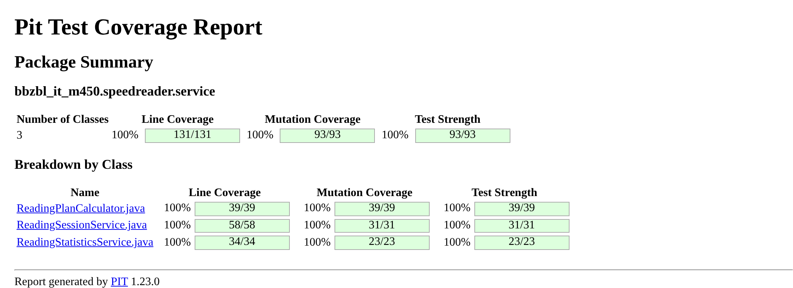

# Mutation Testing (PIT)

Part 3 of LB1: proof that the unit tests of Part 1 and Part 2 are complete.
Target: **no surviving mutants (mutation score 100 %)**.

## 1. What PIT does

PIT changes the compiled code of our service classes in small ways. Every changed version is a **mutant**.
For each mutant PIT runs our unit tests:

| Status | Meaning |
|---|---|
| **Killed** | at least one test fails → the tests noticed the bug (good) |
| **Survived** | all tests still pass → the tests have a gap (bad) |
| **No coverage** | no test executes this line at all |

Mutation score = killed mutants / all mutants.
Unlike line coverage, it shows whether the tests actually **check** the result, not only whether a line was executed.

## 2. How to run it

From `backend/` (`.\mvnw.cmd` on Windows, `./mvnw` elsewhere):

```bash
./mvnw test
./mvnw org.pitest:pitest-maven:mutationCoverage
```

Report: `backend/target/pit-reports/index.html` (HTML + `mutations.xml`, not timestamped, always the same path).

In CI (`.github/workflows/ci.yml`) PIT runs on every push and pull request after the unit tests.
The report is uploaded as the artifact **`pit-report`**: *Actions → run → Summary → Artifacts*.

## 3. Configuration (`backend/pom.xml`)

| Setting | Value | Why |
|---|---|---|
| PIT version | 1.23.0 + `pitest-junit5-plugin` 1.2.3 | JUnit 5 support |
| `targetClasses` | `ReadingPlanCalculator`, `ReadingSessionService`, `ReadingStatisticsService` | only the tested units; entities, Lombok code, config and the main class would produce mutants no unit test can sensibly kill |
| `targetTests` | `bbzbl_it_m450.speedreader.service.*Test` | our unit tests |
| `mutators` | `DEFAULTS` | PIT's standard set (see §4) |
| `outputFormats` | HTML, XML | HTML for the demo, XML for evaluation |
| `mutationThreshold` | 100 | the build (and CI) fails as soon as a single mutant survives |

## 4. Mutators with examples from our code

PIT 1.23 `DEFAULTS` produced the following mutators. *Killed by* is the test PIT reports as the first one that killed the mutant.

### 4.1 `ReadingSessionService` (Part 1)

| Mutator | What it changes | Example from our code | Killed by |
|---|---|---|---|
| `CONDITIONALS_BOUNDARY` | `<` ↔ `<=`, `>` ↔ `>=` | `request.wpm() < MIN_WPM` → `request.wpm() <= MIN_WPM` | `acceptsWpmAtBoundaries` (wpm 60 must be accepted) |
| | | `request.wordsRead() > text.getWordCount()` → `>=` | `wordsReadEqualToWordCount` (100 of 100 words is accepted) |
| `REMOVE_CONDITIONALS_ORDER_ELSE` | replaces a `<` / `>` comparison with `false`, so the `if` never runs | `if (request.wordsRead() < 0)` → `if (false)` | `rejectsNegativeWordsRead` (-1 must throw) |
| `REMOVE_CONDITIONALS_EQUAL_ELSE` | replaces a `==` / `!=` check with `false` | `if (wordsRead == 0) return;` → never returns early | `noBookmarkWhenNothingRead` (`verifyNoInteractions(bookmarks)`) |
| | | `if (!sessions.existsById(id))` → never throws | `deleteSession.throwsWhenMissing` |
| `MATH` | `+` ↔ `-`, `*` ↔ `/` | `getWordPosition() + wordsRead` → `getWordPosition() - wordsRead` | `reachesWordCountExactly` (50 + 50 must be exactly 100) |
| `VOID_METHOD_CALLS` | removes a call to a `void` method | removes `sessions.deleteById(sessionId)` | `deletesExistingSession` (`verify(sessions).deleteById(5L)`) |
| | | removes `validate(request)` | the validation tests (invalid input must throw) |
| | | removes `updateBookmark(...)` / `setWordPosition(...)` | bookmark tests (`ArgumentCaptor` on `bookmarks.save`) |
| `NULL_RETURNS` | returns `null` instead of an object | `return saved;` → `return null;` | `returnsSavedInstance` (`assertSame`) |
| | | lambda in `orElseThrow(...)` returns `null` instead of the exception | `unknownUser`, `unknownText`, `getSession.throwsWhenMissing` (`assertThrows`) |
| `EMPTY_RETURNS` | returns an empty value (`List.of()`, `""`, `Optional.empty()`) | `getSessionsForUser` returns `Collections.emptyList()` | `returnsSessions` (`assertSame` on the non-empty list) |

Result: **31 mutants, 31 killed, 100 %** (line coverage 58/58).

### 4.2 `ReadingPlanCalculator` (Part 2, A)

| Mutator | What it changes | Example from our code | Killed by |
|---|---|---|---|
| `CONDITIONALS_BOUNDARY` | `<` ↔ `<=`, `>` ↔ `>=` | `core.length() > 8` → `core.length() >= 8` | `lengthIgnoresPunctuation` |
| | | `coreLength <= 5` → `coreLength < 5` | `usesOffsetForCoreLength` (`hello` → ORP 1) |
| `REMOVE_CONDITIONALS_ORDER_ELSE` | replaces a `<` / `>` comparison with `false` | `if (coreLength <= 1) return 0;` → never returns 0 | `usesOffsetForCoreLength` (`a` → ORP 0) |
| `REMOVE_CONDITIONALS_EQUAL_ELSE` | replaces a `==` / `!=` check with `false` | `if (text == null)` → never throws `IllegalArgumentException` | `rejectsNull` (expects `IllegalArgumentException`, the mutant gives a `NullPointerException`) |
| | | `if (word.matches(".*[.!?]"))` → never adds the sentence pause | `sentenceEnd` |
| `MATH` | `+` ↔ `-`, `*` ↔ `/` | `MS_PER_MINUTE / wpm` → `MS_PER_MINUTE * wpm` | `longWord` (exact ms value) |
| | | `factor += 1.0` → `factor -= 1.0` | `sentenceEnd` (`word.` → 400 ms) |
| | | `word.indexOf(core) + orpOffset(...)` → `-` | `usesOffsetForCoreLength` |
| `PRIMITIVE_RETURNS` | returns `0` instead of a number | `orpOffset` returns `0` instead of `4` | `usesOffsetForCoreLength` (`internationals` → 4) |
| | | `delayMs` returns `0` | `longWord` |
| `TRUE_RETURNS` | a `boolean` lambda always returns `true` | filter `!core(token).isEmpty()` always `true` | `dropsPunctuationOnlyTokens` (`-` and `...` must be dropped) |
| `EMPTY_RETURNS` | returns an empty value | `tokenize` returns `Collections.emptyList()` | `keepsHyphenatedWords` |
| | | `core(...)` returns `""` | `usesOffsetForCoreLength` |
| `NULL_RETURNS` | returns `null` instead of an object | `createPlan` returns `null` | `createsPlan` |
| `VOID_METHOD_CALLS` | removes a call to a `void` method | removes `validateWpm(wpm)` in `createPlan` | `rejectsInvalidWpmWithEmptyText` (with empty text `delayMs` is never called, so only this check can throw) |

### 4.3 `ReadingStatisticsService` (Part 4, C)

| Mutator | What it changes | Example from our code | Killed by |
|---|---|---|---|
| `CONDITIONALS_BOUNDARY` | `<` ↔ `<=`, `>` ↔ `>=` | `score >= 80` → `score > 80` | `recommendedBoundaryAtScore80` (score 80 → 330) |
| | | `score < 60` → `score <= 60` | `recommendedSlowsDownForBadComprehension` (score 60 → 300) |
| `REMOVE_CONDITIONALS_EQUAL_ELSE` | replaces a `==` / `!=` check with `false` | `if (list.isEmpty())` → never returns early | `averageIsEmptyWhenNoSessions` (the mutant returns `NaN` instead of empty) |
| `REMOVE_CONDITIONALS_ORDER_ELSE` | replaces a `<` / `>` comparison with `false` | `score >= 80` → `false` (never speeds up) | `recommendedSpeedsUpForGoodComprehension` |
| `MATH` | `+` ↔ `-`, `*` ↔ `/` | `totalSeconds / 60.0` → `totalSeconds * 60.0` | `averageOfOneSession` (300 words / 60 s → 300.0) |
| | | `totalWords / totalMinutes` → `*` | `averageOfSeveralSessions` |
| | | `average * 1.10` → `average / 1.10` | `recommendedIsClampedToMax` (1500 × 1.1 is clamped to 1500, the mutant gives 1360) |
| | | `Math.round(average / 10.0) * 10` → `average * 10.0` | `recommendedIsAverageOfRecentWpm` (→ 310) |
| `PRIMITIVE_RETURNS` | returns `0` instead of a number | `getRecommendedWpm` returns `0` | `recommendedIsAverageOfRecentWpm` |
| `NULL_RETURNS` | returns `null` instead of an object | `return OptionalDouble.of(...)` → `return null` | `averageOfOneSession` |

**Equivalent mutant (example for the demo):** in an earlier version, the helper `averageScore` had an `if (count == 0)` check. Removing it (`REMOVE_CONDITIONALS_EQUAL_ELSE`) changed nothing: `0 / 0` is `NaN`, and `NaN >= 80` and `NaN < 60` are both `false`, so no test could ever kill this mutant. Instead of accepting less than 100 %, the code was refactored to `IntStream.average()`, which returns empty by itself, so the check (and the mutant) disappeared. Details: [tdd-log.md](tdd-log.md).

## 5. Results

Run on 11.11.2026, PIT 1.23.0, 113 unit tests green.

| Class | Owner | Mutants | Killed | Score |
|---|---|---|---|---|
| `ReadingSessionService` | B | 31 | 31 | **100 %** |
| `ReadingPlanCalculator` | A | 39 | 39 | **100 %** |
| `ReadingStatisticsService` | C | 23 | 23 | **100 %** |
| **Total** | | **93** | **93** | **100 %** |

Line coverage of the mutated classes: 131/131 (100 %). Test strength: 100 %.

| Mutator | Generated | Killed |
|---|---|---|
| `MATH` | 18 | 18 |
| `CONDITIONALS_BOUNDARY` | 16 | 16 |
| `REMOVE_CONDITIONALS_ORDER_ELSE` | 16 | 16 |
| `REMOVE_CONDITIONALS_EQUAL_ELSE` | 13 | 13 |
| `NULL_RETURNS` | 12 | 12 |
| `PRIMITIVE_RETURNS` | 8 | 8 |
| `VOID_METHOD_CALLS` | 6 | 6 |
| `EMPTY_RETURNS` | 3 | 3 |
| `TRUE_RETURNS` | 1 | 1 |

Since `mutationThreshold` is 100, CI fails as soon as one of these mutants survives.



## 6. Lessons learned

- **Assert exact values.** `assertNotNull` or `size() > 0` let `MATH` and return-value mutants survive.
- **Test both sides of every boundary** (e.g. wpm 59 rejected *and* 60 accepted), otherwise `CONDITIONALS_BOUNDARY` survives.
- **Verify side effects.** Without `verify(...)` / `verifyNoInteractions(...)`, `VOID_METHOD_CALLS` on `save` / `deleteById` survive.
- **Inject a `Clock`** instead of `LocalDateTime.now()`, so dates are deterministic.
- **Avoid equivalent mutants** (a mutant that behaves exactly like the original and can never be killed): no redundant or unreachable conditions, use `Math.min` / `Math.max` for clamping.
- **No `@SpringBootTest`**: PIT runs every test many times, a Spring context would be slow and needs a database.
